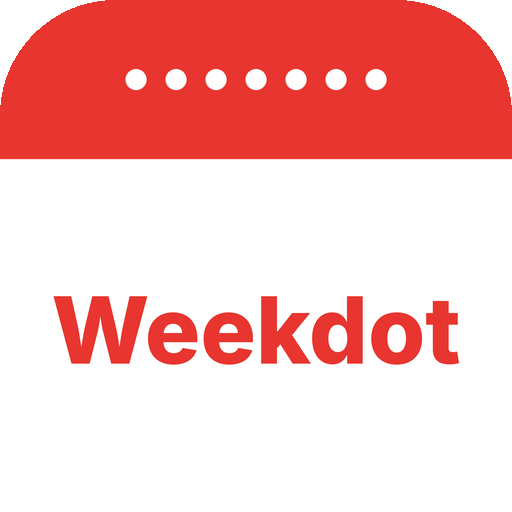

<p align="center"></p>

<h1 align="center">Weekdot</h1>
<p align="center"><b>Your week at a glance.</b><br>A calendar for iPhone, iPad, Mac and Apple Watch — day, week (7 days), month and year views on top of the calendars you already use.</p>

---

## Features

**Views**
- Day, **week (7 days by default, 1–7 configurable)**, month, year and list
- Week starts on any day, week numbers, weekend shading, pinch to zoom the hours, current-time line
- Year view with busy-day heat map; tap a month/day to jump in
- Optional weather forecast above the days (Open-Meteo, approximate location)

**Events**
- Create, edit, delete; all-day, repeating (daily, weekdays, weekly, 2-weekly, monthly, yearly), alerts, URL, notes
- Drag to move (also across days), drag the handle to change the length, drag between days in the month view
- Copy & paste, duplicate, share as text or `.ics`
- Own **colour and emoji** per event, plus automatic **rules** ("Birthday" → 🎂 pink)
- **Templates** for events you plan often, and auto-fill suggestions from earlier events
- "This event / future events" choice for repeating events

**Calendars**
- Uses every calendar of the Calendar app: iCloud, Google, Outlook, Exchange, Yahoo, CalDAV, subscriptions, birthdays
- Show/hide calendars, **calendar sets** (Work, Family …), new calendars (iCloud or on device), edit colour/name, delete
- Subscribe to any `.ics`/webcal link, one-tap **public holiday** calendars for 25+ countries

**Everywhere**
- **iCloud sync** of Weekdot's own data (settings, templates, sets, rules, colours, emoji) — events sync through your accounts
- **Widgets**: Today (live day and date), Up Next, Week; lock-screen widgets on iPhone
- **Apple Watch** app: your day with a 7-day strip, and the coming week
- **Mac**: native app with keyboard shortcuts (⌘N, ⌘T, ⌘F, ⌘1–5, ⌘←/→)
- **34 languages**, following the device language (per-app language on iPhone/iPad)
- Light and dark mode — the app icon follows it too (white / black, iOS 18+)
- Week view as a grid of day boxes (like WeekCal) or as a time line

## Project

| Folder | What |
|---|---|
| `Weekdot/` | App for iPhone, iPad and Mac (one multiplatform SwiftUI target) |
| `WeekdotWatch/` | Apple Watch app |
| `WeekdotWidgets/` | Widgets (iOS + macOS) |
| `Shared/` | Code, assets and string catalogs used by all targets |
| `Config/` | Info.plist and entitlements |
| `website/` | Website (static, all languages) — published with GitHub Pages |
| `tools/` | Generators for the Xcode project, icons and translations |

- Bundle ID `nl.lrvdlinden.weekdot` (watch: `.watchkitapp`, widgets: `.widgets`), team `EU3UY476T6`
- iOS/iPadOS 17+, macOS 14+, watchOS 10+ · Xcode 16 or newer
- Capabilities: iCloud (Key-value storage), App Groups (`group.nl.lrvdlinden.weekdot`), Calendars; on the Mac also App Sandbox with Calendars, Location and outgoing network

### Open in Xcode

Open `Weekdot.xcodeproj`, choose the **Weekdot** scheme and a device or *My Mac*. Signing is automatic; Xcode creates the App IDs, the app group and the iCloud key-value store the first time.

New Swift files in the folders above are picked up automatically. Regenerate the project only when targets or build settings change:

```sh
python3 tools/gen_xcodeproj.py   # Xcode project
python3 tools/make_icons.py      # app icons, splash logo, website images
python3 tools/build_strings.py   # string catalogs + website translations from tools/i18n/
```

### Translations

All texts live in `tools/i18n/<language>.json` (`app`, `plist` and `web` parts). After changing them, run `tools/build_strings.py`; it writes `Shared/Localizable.xcstrings`, `Shared/InfoPlist.xcstrings` and `website/i18n.js`. New UI strings: run `tools/extract_strings.py` first to refresh the key list.

### Builds

Every push to `main` builds iOS, macOS and watchOS on GitHub Actions (unsigned) to catch compile errors. The result is posted as a comment on the commit.

## Website

`website/` is deployed by `.github/workflows/pages.yml` to GitHub Pages (`https://lrvdlinden.github.io/Agenda/`). Turn on Pages once: *Settings › Pages › Source: GitHub Actions*. The site picks the visitor's language automatically and has a language menu.

See [CHANGELOG.md](CHANGELOG.md) for versions.
